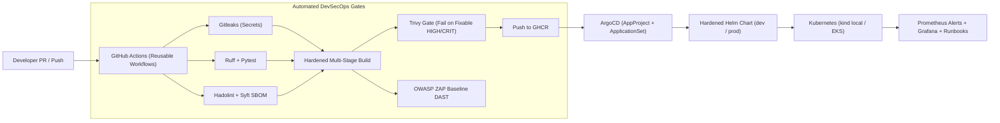

# DevSecOps & GitOps Reference Platform

[](https://github.com/lampreave/devsecops-gitops-platform/actions/workflows/platform-pipeline.yml)
[](https://github.com/lampreave/devsecops-gitops-platform/actions/workflows/dast-owasp-zap.yml)
[](LICENSE)

A production-style **DevSecOps, GitOps, and Cloud Infrastructure reference platform** built by [Eduardo Lampreave](https://www.linkedin.com/in/eduardolampreave) (Senior DevOps Engineer · Certified DevSecOps Professional).

It demonstrates end-to-end secure software delivery patterns — reusable GitHub Actions workflows, branch-policy build-blocking security gates, hardened Kubernetes Helm charts, ArgoCD App-of-Apps/ApplicationSet delivery, keyless AWS OIDC Terraform modules, Linux server hardening with Ansible, SRE observability alerts, ADRs, and operational runbooks — with **$0 cloud cost** and full local reproducibility.

> **Note on confidentiality:** 100% of the code, manifests, workflows, and documentation in this repository are original reference implementations using a synthetic demo service. No proprietary employer code, configs, or secrets are included.

---

## Architecture



---

## Reviewer Quick Tour (90 Seconds)

| Area | Path | What It Demonstrates |
|---|---|---|
| **Reusable CI/CD & Security Gates** | [`.github/workflows/`](.github/workflows/) | Parameterized `workflow_call` pipelines: Gitleaks, Ruff, Pytest, Hadolint, Syft CycloneDX SBOM, Trivy branch-policy blocking gate, GHCR publish, and OWASP ZAP Baseline DAST. |
| **Hardened Helm Chart** | [`charts/demo-service/`](charts/demo-service/) | Non-root `UID 10001`, `readOnlyRootFilesystem`, `drop: ["ALL"]`, `RuntimeDefault` seccomp, default-deny `NetworkPolicy`, `HPA`, `PDB`, `ServiceMonitor`, and `dev`/`prod` value overlays validated by `helm lint`, `kubeconform`, and `trivy config`. |
| **GitOps Delivery (ArgoCD)** | [`gitops/argocd/`](gitops/argocd/) | Scoped `AppProject`, `root-app.yaml` (App-of-Apps), and `ApplicationSet` (automated `prune` + `selfHeal` in `dev`, controlled manual sync in `prod`). |
| **Cloud IaC (Terraform)** | [`infra/terraform/`](infra/terraform/) | Modular AWS GitHub Actions OIDC federation (zero static keys) + KMS-encrypted immutable ECR repository with `scan_on_push`, validated with `terraform validate` and `trivy config`. |
| **Linux Ops & Hardening (Ansible)** | [`infra/ansible/linux-hardening.yml`](infra/ansible/linux-hardening.yml) | Idempotent server hardening playbook (SSH hardening, `sysctl` network controls, `auditd`, `fail2ban`, unattended upgrades), linted via `ansible-lint`. |
| **SRE Observability** | [`observability/`](observability/) | Prometheus SLO alert rules (`HighErrorRate`, `PodCrashLooping`, `TargetDown`) linked to runbooks, plus importable Grafana dashboard JSON. |
| **ADRs & Runbooks** | [`docs/adr/`](docs/adr/) · [`docs/runbooks/`](docs/runbooks/) | Architecture Decision Records explaining trade-offs + concise incident/CVE/rollback runbooks. |

---

## Quick Verification Locally

### 1. Run unit & security-header contract tests
```bash
PYTHONPATH=app pytest -v app/tests
```

### 2. Validate Helm chart (dev & prod overlays)
```bash
helm lint charts/demo-service -f charts/demo-service/values-dev.yaml
helm lint charts/demo-service -f charts/demo-service/values-prod.yaml
helm template demo-prod charts/demo-service -n demo-prod -f charts/demo-service/values-prod.yaml
```

### 3. Build & test the hardened container locally
```bash
docker build -t demo-service:local -f app/Dockerfile app
docker run --rm -p 8080:8080 --read-only demo-service:local
# In another terminal:
curl -i http://127.0.0.1:8080/healthz
curl -s http://127.0.0.1:8080/metrics
```

### 4. Bootstrap full local Kubernetes + ArgoCD stack (`kind`)
```bash
./scripts/local-bootstrap.sh
```

---

## Design Highlights

- **Zero runtime dependency bloat:** `demo-service` uses Python's standard library with structured JSON logging, Prometheus `/metrics`, graceful `SIGTERM` draining, and strict HTTP security headers (`CSP`, `X-Frame-Options`, `X-Content-Type-Options`) to minimize container CVE surface.
- **No static cloud credentials:** CI/CD cloud authentication uses short-lived OIDC tokens scoped to repository and branch ([ADR-003](docs/adr/003-oidc-keyless-cloud-auth.md)).
- **Explicit, auditable exceptions:** Any scanner exception (such as AWS's API requirement for `*` on `ecr:GetAuthorizationToken`) is narrowly scoped and documented inline rather than disabling rules globally.
